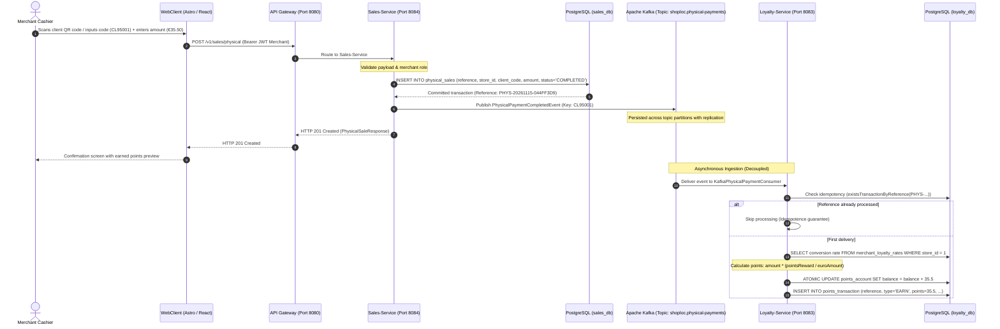

# In-Store Physical Checkout & Loyalty Points Event-Driven Architecture (SLE-36)

Technical and architectural specification for the asynchronous integration between **ShopLoc Sales Service** and **ShopLoc Loyalty Service** via Apache Kafka.

---

## 1. Executive Summary & Goals

* **User Story**: [SLE-36](https://deloisonantonin8-1788722336642.atlassian.net/browse/SLE-36) — *Automatically credit loyalty points upon in-store physical checkout with customer card scan*.
* **Subtasks Covered**:
  * **SLE-171**: Kafka Broker configuration and EDA checkout event schema.
  * **SLE-172**: Kafka event producer in `Sales-Service` upon physical sale confirmation.
  * **SLE-173**: Kafka consumer in `Loyalty-Service` and conversion rate lookup.
  * **SLE-174**: Atomic balance credit and ledger transaction recording.
  * **SLE-175**: End-to-end integration tests (TDD).

### Business Problem & Objectives
When a merchant cashier rings up a sale in a local boutique:
1. The sale must be confirmed **synchronously and immediately** without delaying the in-store queue.
2. The customer's loyalty card (scanned via QR code/barcode or manual client code entry) must trigger **immediate points accumulation**.
3. Points calculation and balance crediting must be **decoupled** from the sales transaction to guarantee high availability: a failure or rolling upgrade of `Loyalty-Service` must never cause a cashier transaction to fail or hang.

---

## 2. Global Architecture & Sequence Diagram



---

## 3. Kafka Event Contract & Schema

### Topic Configuration
* **Topic Name**: `shoploc.physical-payments`
* **Default Partitions**: 4 (aligned with HPA consumer scaling)
* **Replication Factor**: 1 in dev / 3 in multi-node clusters
* **Partition Key**: `clientCode` (or `customerId`), guaranteeing strict chronological message ordering per customer.

### Payload Schema (`PhysicalPaymentCompletedEvent`)

```json
{
  "transactionReference": "PHYS-20261115-044FF3D9",
  "storeId": 1,
  "clientCode": "CL95001",
  "customerId": "b8b86935-f925-415e-ad2c-4181a7860f71",
  "amount": 35.50,
  "currency": "EUR",
  "paymentMethod": "PHYSICAL_CASH",
  "timestamp": "2026-11-15T23:32:29.909948587Z"
}
```

### Field Definitions

| Field | Type | Required | Description |
| :--- | :--- | :--- | :--- |
| `transactionReference` | `String` | **Yes** | Unique physical sale reference (idempotency key: `PHYS-YYYYMMDD-XXXXXXXX`). |
| `storeId` | `Long` | **Yes** | Store identifier used to resolve the active merchant conversion rate. |
| `clientCode` | `String` | No | Scanned alphanumeric loyalty card code (e.g., `CL95001`). |
| `customerId` | `String` | No | Customer UUID in `users-service`. |
| `amount` | `BigDecimal` | **Yes** | In-store sale total amount (strictly positive). |
| `currency` | `String` | **Yes** | ISO-4217 3-letter currency code (e.g., `EUR`). |
| `paymentMethod` | `String` | **Yes** | Cash/Card indicator (`PHYSICAL_CASH`, `PHYSICAL_CARD`, etc.). |
| `timestamp` | `Instant` | **Yes** | Timestamp of checkout validation. |

---

## 4. Resilience & Error Handling

### 4.1. Non-Blocking Fail-Safe Publication
Event publication in `Sales-Service` is wrapped in a fail-safe try/catch block. If the Kafka cluster experiences transient network partitions:
* The cashier's checkout transaction **remains committed** in the local database.
* The failure is logged with complete contextual metadata (`txRef`, `storeId`, `clientCode`, `amount`).
* In-store physical customers are never stranded at the cash register.

### 4.2. Consumer Idempotence (Duplicate Protection)
Kafka guarantees *at-least-once* delivery. If network retries duplicate an event:
* `Loyalty-Service` performs an atomic uniqueness check against `points_transaction.transaction_reference`.
* Duplicate references are logged and discarded without modifying the customer's balance.

### 4.3. Type Mapping & Cross-Service Deserialization
Because `Sales-Service` and `Loyalty-Service` are distinct autonomous microservices, they do not share binary classpath dependencies:
* `JsonSerializer` in `Sales-Service` sends `__TypeId__`.
* `JsonDeserializer` in `Loyalty-Service` uses explicit type mapping:
  ```yaml
  spring.json.type.mapping: "fr.miage.collectivit.salesservice.dto.event.PhysicalPaymentCompletedEvent:fr.miage.collectivit.loyaltyservice.infrastructure.adapter.in.kafka.dto.PhysicalPaymentCompletedEvent"
  ```
* This prevents any `ClassNotFoundException` while maintaining strict compile-time boundaries.

### 4.4. Dead Letter Queue (DLQ / DLT) & Store Name Resolution
* **Dead Letter Topic**: Corrupted messages or unrecoverable processing failures trigger `DeadLetterPublishingRecoverer` (after 2 retry attempts with 1-second backoff), forwarding the failed payload to `shoploc.physical-payments.DLT` without stalling topic consumption.
* **Commercial Store Resolution**: In `Loyalty-Service`, `PointsAccountService` queries `StoreVerificationPort.findStoreName(storeId)` via `StoreServiceHttpAdapter` (`GET /v1/stores/{storeId}`) to record the store's human-readable name (e.g., "Burger King Lille") directly in the customer's ledger transaction history.

---

## 5. REST API Specifications

### `POST /v1/sales/physical`
* **Authorization**: Bearer JWT (`Role: MERCHANT` or `Role: ADMIN`)
* **Request Body**:
  ```json
  {
    "storeId": 1,
    "clientCode": "CL95001",
    "customerId": "b8b86935-f925-415e-ad2c-4181a7860f71",
    "amount": 35.50,
    "currency": "EUR",
    "paymentMethod": "PHYSICAL_CASH"
  }
  ```
* **Response `201 Created`**:
  ```json
  {
    "transactionReference": "PHYS-20261115-044FF3D9",
    "storeId": 1,
    "merchantId": "a862b85e-f295-4c44-81c1-6c34d6474657",
    "clientCode": "CL95001",
    "customerId": "b8b86935-f925-415e-ad2c-4181a7860f71",
    "amount": 35.50,
    "currency": "EUR",
    "pointsEarned": 35.5,
    "pointsRateApplied": "1.00 EUR = 1.0 PTS",
    "paymentMethod": "PHYSICAL_CASH",
    "status": "COMPLETED",
    "timestamp": "2026-11-15T23:32:29.909948587Z"
  }
  ```

### `GET /v1/sales/physical/{reference}`
* **Authorization**: Bearer JWT (`Role: CLIENT` for own sales, `Role: MERCHANT`, `Role: ADMIN`)
* **Response `200 OK`**: Returns the physical sale audit record.

---

## 6. Testing & Quality Assurance

1. **Unit Tests**:
   - `PhysicalPaymentEventPublisherTest`: Mocks `KafkaTemplate` and asserts correct topic, key (`clientCode`), and payload construction.
   - `PointsAccountServiceTest`: Verifies proportional points conversion math, rate defaults, and customer code fallback resolution.
2. **Integration Tests (Embedded Kafka)**:
   - `PhysicalPaymentKafkaIntegrationTest`: Verifies real broker end-to-end event production, topic consumption, and points ledger persistence.
3. **End-to-End Containerized Validation**:
   - Dockerized verification against live Kafka cluster and PostgreSQL containers.

