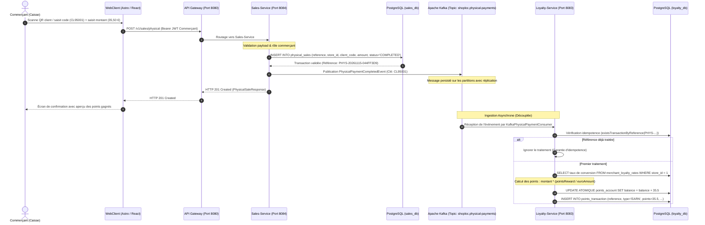

# Architecture Événementielle : Paiement Physique en Caisse & Points de Fidélité (SLE-36)

Spécification technique et architecturale pour l'intégration asynchrone entre le **ShopLoc Sales Service** et le **ShopLoc Loyalty Service** via Apache Kafka.

---

## 1. Résumé Exécutif & Objectifs

* **User Story** : [SLE-36](https://deloisonantonin8-1788722336642.atlassian.net/browse/SLE-36) — *Créditer automatiquement des points de fidélité lors d'un passage en caisse physique avec scan de la carte client*.
* **Sous-tâches couvertes** :
  * **SLE-171** : Configuration du broker Kafka et schéma d'événement de paiement EDA.
  * **SLE-172** : Producteur d'événements Kafka dans `Sales-Service` lors de la confirmation d'une vente physique.
  * **SLE-173** : Consommateur Kafka dans `Loyalty-Service` et recherche du taux de conversion commerçant.
  * **SLE-174** : Crédit atomique du solde et enregistrement de la transaction dans le grand livre (ledger).
  * **SLE-175** : Tests d'intégration de bout en bout (TDD).

### Problématique Métier & Objectifs
Lorsqu'un commerçant encaisse une vente en boutique physique :
1. La vente doit être confirmée **de manière synchrone et immédiate** sans ralentir la file d'attente en caisse.
2. La carte de fidélité du client (scannée via QR code/code-barres ou saisie manuelle du code client) doit déclencher **l'accumulation immédiate des points**.
3. Le calcul des points et le crédit du solde doivent être **découplés** de la transaction de vente pour garantir une haute disponibilité : une indisponibilité ou un redémarrage de `Loyalty-Service` ne doit jamais bloquer ou faire échouer l'encaissement en caisse.

---

## 2. Architecture Globale & Diagramme de Séquence



---

## 3. Contrat d'Événement Kafka & Schéma

### Configuration du Topic
* **Nom du Topic** : `shoploc.physical-payments`
* **Partitions par défaut** : 4 (aligné avec la mise à l'échelle HPA des consommateurs)
* **Facteur de réplication** : 1 en dev / 3 sur les clusters multi-nœuds
* **Clé de partition** : `clientCode` (ou `customerId`), garantissant un ordre chronologique strict par client.

### Schéma du Payload (`PhysicalPaymentCompletedEvent`)

```json
{
  "transactionReference": "PHYS-20261115-044FF3D9",
  "storeId": 1,
  "clientCode": "CL95001",
  "customerId": "b8b86935-f925-415e-ad2c-4181a7860f71",
  "amount": 35.50,
  "currency": "EUR",
  "paymentMethod": "PHYSICAL_CASH",
  "timestamp": "2026-11-15T23:32:29.909948587Z"
}
```

### Définitions des Champs

| Champ | Type | Obligatoire | Description |
| :--- | :--- | :--- | :--- |
| `transactionReference` | `String` | **Oui** | Référence unique de la vente physique (clé d'idempotence : `PHYS-YYYYMMDD-XXXXXXXX`). |
| `storeId` | `Long` | **Oui** | Identifiant du commerce pour résoudre le taux de conversion actif. |
| `clientCode` | `String` | Non | Code alphanumérique scanné de la carte de fidélité (ex. `CL95001`). |
| `customerId` | `String` | Non | Identifiant UUID public du client dans `users-service`. |
| `amount` | `BigDecimal` | **Oui** | Montant total de la vente en caisse (strictement positif). |
| `currency` | `String` | **Oui** | Code devise ISO-4217 sur 3 lettres (ex. `EUR`). |
| `paymentMethod` | `String` | **Oui** | Moyen de paiement physique (`PHYSICAL_CASH`, `PHYSICAL_CARD`, etc.). |
| `timestamp` | `Instant` | **Oui** | Horodatage UTC de validation de la transaction. |

---

## 4. Résilience & Gestion des Erreurs

### 4.1. Publication Tolérante aux Pannes (Fail-Safe)
La publication d'événements dans `Sales-Service` est encapsulée dans un bloc de capture d'erreur sécurisé. En cas de coupure temporaire du cluster Kafka :
* La vente en caisse **reste validée et enregistrée** dans la base de données locale.
* L'erreur est logguée avec toutes les métadonnées contextuelles (`txRef`, `storeId`, `clientCode`, `amount`).
* Les clients en magasin ne sont jamais bloqués en caisse.

### 4.2. Idempotence du Consommateur (Protection contre les Doublons)
Kafka applique une sémantique de livraison *au moins une fois* (at-least-once). Si des rejeux réseau dupliquent un événement :
* `Loyalty-Service` effectue une vérification d'unicité atomique sur `points_transaction.transaction_reference`.
* Les références déjà traitées sont ignorées sans impacter le solde du client.

### 4.3. Typage et Désérialisation Inter-Services
Puisque `Sales-Service` et `Loyalty-Service` sont des microservices autonomes distincts, ils ne partagent pas de dépendances binaires :
* Le `JsonSerializer` de `Sales-Service` émet le header `__TypeId__`.
* Le `JsonDeserializer` de `Loyalty-Service` utilise un mapping explicite de types :
  ```yaml
  spring.json.type.mapping: "fr.miage.collectivit.salesservice.dto.event.PhysicalPaymentCompletedEvent:fr.miage.collectivit.loyaltyservice.infrastructure.adapter.in.kafka.dto.PhysicalPaymentCompletedEvent"
  ```
* Cela prévient toute exception `ClassNotFoundException` tout en préservant le découplage strict.

### 4.4. File de Rebut (Dead Letter Queue / DLT) & Résolution du Nom du Commerce
* **Dead Letter Topic** : Les messages corrompus ou en échec non récupérable déclenchent le `DeadLetterPublishingRecoverer` (après 2 tentatives avec backoff d'une seconde), transférant le message vers `shoploc.physical-payments.DLT` sans bloquer le topic principal.
* **Résolution du Commerce** : Dans `Loyalty-Service`, `PointsAccountService` interroge `StoreVerificationPort.findStoreName(storeId)` via `StoreServiceHttpAdapter` (`GET /v1/stores/{storeId}`) pour enregistrer le nom lisible du commerce (ex. "Boulangerie Le Moulin") dans l'historique de fidélité du client.

---

## 5. Spécifications des Endpoints REST

### `POST /v1/sales/physical`
* **Autorisation** : Bearer JWT (`Rôle : MERCHANT` ou `Rôle : ADMIN`)
* **Corps de la requête** :
  ```json
  {
    "storeId": 1,
    "clientCode": "CL95001",
    "customerId": "b8b86935-f925-415e-ad2c-4181a7860f71",
    "amount": 35.50,
    "currency": "EUR",
    "paymentMethod": "PHYSICAL_CASH"
  }
  ```
* **Réponse `201 Created`** :
  ```json
  {
    "transactionReference": "PHYS-20261115-044FF3D9",
    "storeId": 1,
    "merchantId": "a862b85e-f295-4c44-81c1-6c34d6474657",
    "clientCode": "CL95001",
    "customerId": "b8b86935-f925-415e-ad2c-4181a7860f71",
    "amount": 35.50,
    "currency": "EUR",
    "pointsEarned": 35.5,
    "pointsRateApplied": "1.00 EUR = 1.0 PTS",
    "paymentMethod": "PHYSICAL_CASH",
    "status": "COMPLETED",
    "timestamp": "2026-11-15T23:32:29.909948587Z"
  }
  ```

### `GET /v1/sales/physical/{reference}`
* **Autorisation** : Bearer JWT (`Rôle : CLIENT` pour ses propres ventes, `Rôle : MERCHANT`, `Rôle : ADMIN`)
* **Réponse `200 OK`** : Retourne le détail de la transaction de vente physique.

---

## 6. Tests & Assurance Qualité

1. **Tests Unitaires** :
   - `PhysicalPaymentEventPublisherTest` : Mocke `KafkaTemplate` et valide le topic, la clé (`clientCode`) et la charge utile.
   - `PointsAccountServiceTest` : Vérifie le calcul proportionnel de conversion de points et les valeurs par défaut.
2. **Tests d'Intégration (Embedded Kafka)** :
   - `PhysicalPaymentKafkaIntegrationTest` : Vérifie la production réelle, la consommation sur broker Kafka et la persistance en base.
3. **Validation Bout-en-Bout Conteneurisée** :
   - Validation via Docker Compose avec les conteneurs PostgreSQL et Kafka actifs.
